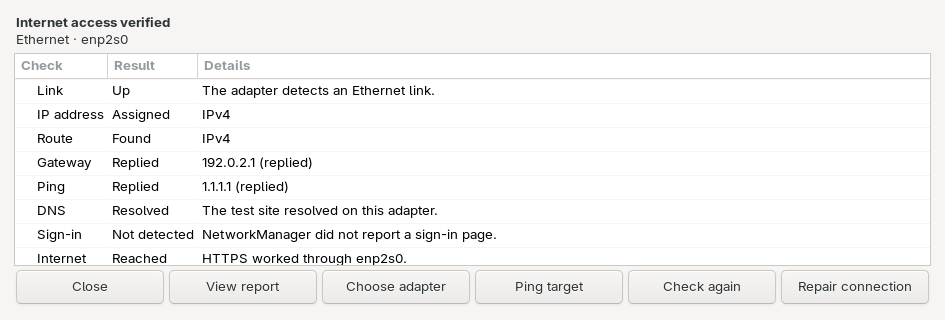
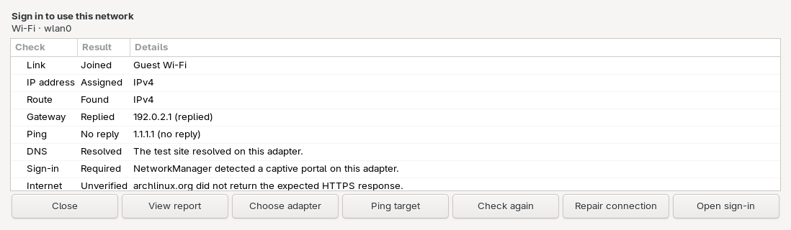

# Network Troubleshooter for Linux

Diagnose and repair one Wi-Fi or Ethernet connection on **Linux with NetworkManager**. You can test a failing adapter while another connection stays online. Local checks and saved-profile repair work during an outage. The desktop app and CLI run the same checks.

## Install

Install Python 3, NetworkManager, iproute2, iputils, curl, and systemd journal tools. Add YAD for the desktop app, `iw` for Wi-Fi link details, and `wl-clipboard` for **Copy redacted** on Wayland. Per-adapter DNS checks use systemd-resolved. On systems without Omarchy’s sign-in launcher, install xdg-utils for browser sign-in.

Run as your desktop user.

```sh
git clone https://github.com/muness/network-troubleshooter.git
cd network-troubleshooter
python3 install.py
```

The installer puts the CLI in `~/.local/bin`. Add that directory to your `PATH` if your shell can’t find `network-troubleshooter`.

## Run a diagnosis

1. Open **Network Troubleshooter** from your app launcher and select the Wi-Fi or Ethernet adapter you want to check.
2. Read the results from **Link** through **Internet**. Use **Open sign-in** if the network requires a login.
3. Choose **Repair connection** to retry a saved NetworkManager profile or wake a suspended USB Ethernet adapter. If repair is unavailable, the app explains what to check first. After an attempt, the app checks internet access through the selected adapter and records each step in the private report.
4. To share results, choose **View report** → **Copy redacted**. The redacted report contains check statuses and repair outcomes. The private report includes adapter details and journal logs and is saved under `${XDG_STATE_HOME:-$HOME/.local/state}/network-troubleshooter/`.



## What the app checks

| Check | What it tells you |
| --- | --- |
| Link | Ethernet detects a cable link, or Wi-Fi has joined a network. |
| IP address | The adapter has an IPv4 or IPv6 address beyond link-local. |
| Route | A route to the test destinations exists through this adapter. |
| Gateway | The adapter’s configured router answers a ping. |
| Ping | A target answers through this adapter. Defaults are `1.1.1.1` and `2606:4700:4700::1111`. Use **Ping target** or `--ping-target IP` to test another address. |
| DNS | systemd-resolved returned an address for `archlinux.org` on this adapter. |
| Sign-in | NetworkManager detected a captive portal, such as a hotel Wi-Fi login page. |
| Internet | An HTTPS request to `archlinux.org` through this adapter returned HTTP 200. |

HTTPS can pass when ping gets no reply. The HTTPS check uses system DNS if the selected adapter yields no verified DNS answer. The HTTPS connection still goes through the selected adapter. Wi-Fi reports also include radio and link details and whether the saved network appears in the scan cache.

## Run from a terminal

Use the interface name from `--list-adapters` in place of `enp2s0` or `wlan0`.

```sh
network-troubleshooter --list-adapters
network-troubleshooter --device enp2s0
network-troubleshooter --device enp2s0 --ping-target 192.168.1.1 --redacted-report
network-troubleshooter --device enp2s0 --repair --redacted-report
network-troubleshooter --device wlan0 --sign-in
```

Add `--yes` to approve repair in a script. A configured driver recovery service may still prompt through polkit. Use `--redacted-report` for shareable output and `--report` for private details. Both print to stdout and send the saved private report path to stderr.

## Sign in to a captive portal

Choose **Open sign-in** when the app detects a portal. If **Try sign-in** appears, the app can open the HTTP probe page to trigger a portal redirect even though the check couldn’t confirm one. After signing in, reopen Network Troubleshooter and check the same adapter again.



By default, the app sends the probe URL to Omarchy’s `omarchy-network-captive-portal` if it’s on your `PATH`. That launcher can pause an active Tailscale exit node during sign-in. Otherwise, the app opens the URL in your default browser with `xdg-open`. Both use normal system routing.

### Configure a sign-in helper

If Ethernet or tethering is also online, the system may send your sign-in browser over that connection. A helper that binds DNS and browser traffic to the selected adapter keeps the sign-in on the network you’re diagnosing. The Wi-Fi setup used to develop this app uses a local Omarchy helper backed by Foyer. [Foyer](https://github.com/tektum/foyer)

Save `portal.json` under `${XDG_CONFIG_HOME:-$HOME/.config}/network-troubleshooter/`. This example assumes you have a helper that implements `--open-device`. Replace the path with its absolute path.

```json
{
  "wifi": ["/home/alex/.local/libexec/omarchy-captive-portal", "--open-device"]
}
```

You can configure `wifi`, `ethernet`, or both. The app appends the adapter name and HTTP probe URL to the argument list. Your helper should return once it opens the window and exit nonzero if launch fails. The app uses the default launcher for any adapter type without an entry.

## Wake USB Ethernet

When a USB Ethernet adapter has no link, the private report identifies the USB device, driver, active configuration, power state, and available kernel messages for that adapter. The Link check flags repeated USB resets and points you toward native driver support when a generic driver is active and the adapter exposes another vendor-specific mode. These clues help narrow the cause after checking the cable and switch port. The diagnostic does not switch USB modes or drivers.

When a USB Ethernet adapter is runtime-suspended and reports no link, **Repair connection** can wake its USB device and wait for NetworkManager to connect. It restores the device’s original USB power policy after checking for a link.

To enable this repair, install the privileged helper from the repository directory.

```sh
pkexec /usr/bin/install -D -o root -g root -m 0755 "$PWD/wake-usb-ethernet" \
  /usr/local/libexec/network-troubleshooter-wake-usb-ethernet
```

## Configure a driver recovery service

If a saved profile fails to reconnect, **Repair connection** can start a configured systemd recovery service through polkit. The adapter must be disconnected, allow autoconnect, and still use the configured driver. Wi-Fi also requires `iw`, an enabled radio, and exactly one Wi-Fi adapter visible to NetworkManager.

### Broadcom Wi-Fi on Apple Silicon

After suspend on Linux, Broadcom Wi-Fi can get stuck. NetworkManager keeps trying to join, and the journal can show repeated `ASSOC-REJECT status_code=16` or scan errors. A `brcmfmac` reload can restore the connection. The issue has been reported on M1 and M2 models. [BCM4378/BCM4387 resume fix](https://github.com/omacom/omarchy-mac/pull/255) · [M2 Pro report](https://github.com/omacom/omarchy/issues/10857) · [M2 Air report](https://github.com/AsahiLinux/linux/issues/439)

Run `lspci -nnk -d 14e4:` to find the PCI ID and check for `Kernel driver in use: brcmfmac`. The helper supports BCM4378 (`14e4:4425`, found in M1 Macs), BCM4387 (`14e4:4433`, found in M1 Pro and Max Macs), and BCM4388 (`14e4:4434`, found in some M2 and M3 Macs). Use the PCI ID to check whether the helper supports your hardware. It requires ARM64, NetworkManager, wpa_supplicant, and the loadable `brcmfmac` and `brcmfmac_wcc` kernel modules. [Broadcom chip IDs](https://github.com/omacom/omarchy/issues/7439) · [Asahi Linux driver notes](https://asahilinux.org/2024/01/fedora-asahi-new/)

If joins also fail right after a fresh boot, check whether an older Omarchy installation set `feature_disable=0x82000` in `/etc/modprobe.d/brcmfmac.conf`. That setting caused association failures on BCM4387. Follow the Omarchy cleanup instructions for that case. [Omarchy Apple Silicon troubleshooting](https://omarchylinux.org/hardware/apple-silicon-asahi/) · [BCM4387 report](https://github.com/omacom/omarchy/issues/7439)

If you already have a guarded recovery service for your chip, use its unit name in the next section. The Broadcom helper below detaches NetworkManager and wpa_supplicant before unloading the driver, then restores NetworkManager management. These commands install it and disable its automatic wake hook so it runs on demand from **Repair connection**. [Helper source](https://github.com/muness/dotfiles/tree/53aacf6c6606a88b7d0acaca6a9d5dbf58e2e60e/scripts/linux/wifi-resume)

```sh
git clone https://github.com/muness/dotfiles.git broadcom-recovery &&
  git -C broadcom-recovery checkout 53aacf6c6606a88b7d0acaca6a9d5dbf58e2e60e &&
  pkexec /usr/bin/python3 "$PWD/broadcom-recovery/scripts/linux/wifi-resume/install.py" &&
  pkexec /usr/bin/systemctl disable dotfiles-wifi-resume.service
```

Use `dotfiles-wifi-resume.service` in the next step. The reload briefly removes the Wi-Fi adapter. Check the service log with `journalctl -b -u dotfiles-wifi-resume.service`.

### Connect the service to Network Troubleshooter

Run the setup as your desktop user. Find the interface and saved profile UUID, then substitute those values and your unit name.

```sh
network-troubleshooter --list-adapters
nmcli -f NAME,UUID,TYPE connection show
network-troubleshooter --configure-recovery dotfiles-wifi-resume.service \
  --device wlan0 --profile YOUR_PROFILE_UUID
```

This writes or replaces `recovery.json` under `${XDG_CONFIG_HOME:-$HOME/.config}/network-troubleshooter/` and records the detected driver. Run setup again if you recreate the profile. Delete that file to remove the service from Network Troubleshooter.

Use **Repair connection** in the desktop app or `network-troubleshooter --device wlan0 --repair`. For Ethernet or another Wi-Fi driver, use the same setup command with a system service that checks its own hardware support and restores the adapter after recovery.

## Open it from OmaDoctor on Omarchy

OmaDoctor’s launcher integration is available in PR #9. With that build, click **Network** next to **Ask AI** to open Network Troubleshooter locally. The button works before or after a scan. [OmaDoctor](https://github.com/Davedes83/OmaDoctor) · [Launcher PR #9](https://github.com/Davedes83/OmaDoctor/pull/9)

For a fresh OmaDoctor install, use the PR branch.

```sh
git clone --branch codex/network-troubleshooter-launcher https://github.com/muness/OmaDoctor.git omadoctor-preview
omarchy plugin add "$PWD/omadoctor-preview" --enable
```

The **Network troubleshooter app** setting defaults to `auto` and shows **Network** when this app is installed. Enter another desktop app ID to launch it instead, or clear the setting to hide the button. This app's ID is `io.github.muness.NetworkTroubleshooter.desktop`.

## Uninstall

Delete `~/.local/bin/network-troubleshooter`. Delete `io.github.muness.NetworkTroubleshooter.desktop` from your user applications directory, which defaults to `~/.local/share/applications`.

[MIT license](LICENSE)
